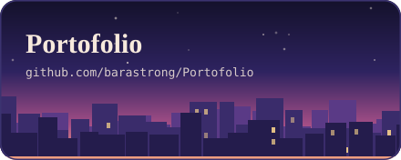
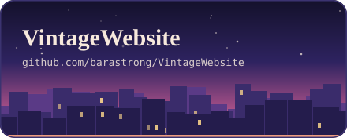
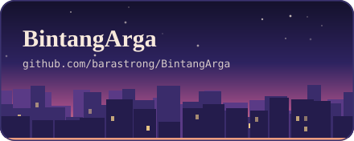
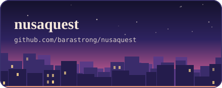

<picture><source media="(prefers-color-scheme: dark)" srcset="about-dark.svg"></picture>

<picture><source media="(prefers-color-scheme: dark)" srcset="stack-dark.svg"></picture>

<picture><source media="(prefers-color-scheme: dark)" srcset="h-projects-dark.svg"></picture>

<picture><source media="(prefers-color-scheme: dark)" srcset="h-activity-dark.svg"></picture>

<picture><source media="(prefers-color-scheme: dark)" srcset="https://github-readme-stats.vercel.app/api?username=barastrong&show_icons=true&custom_title=barastrong%27s%20GitHub%20stats&bg_color=0d1117&title_color=FFB27A&text_color=F7E9DC&icon_color=FF8FA3&border_color=3B3370&border_radius=18"></picture>
<picture><source media="(prefers-color-scheme: dark)" srcset="https://github-readme-stats.vercel.app/api/top-langs/?username=barastrong&layout=compact&langs_count=7&bg_color=0d1117&title_color=FFB27A&text_color=F7E9DC&icon_color=FF8FA3&border_color=3B3370&border_radius=18"></picture>

<picture><source media="(prefers-color-scheme: dark)" srcset="https://streak-stats.demolab.com/?user=barastrong&border_radius=18&background=0d1117&border=3B3370&ring=FFB27A&fire=FF8FA3&currStreakNum=F7E9DC&sideNums=F7E9DC&currStreakLabel=FFB27A&sideLabels=B9B0E0&dates=B9B0E0"></picture>

<picture><source media="(prefers-color-scheme: dark)" srcset="h-contact-dark.svg"></picture>

<a href="mailto:gamemasaw@email.com"><picture><source media="(prefers-color-scheme: dark)" srcset="c-email-dark.svg"></picture></a>
<a href="https://linkedin.com/in/game-masaw-1875133a9"><picture><source media="(prefers-color-scheme: dark)" srcset="c-linkedin-dark.svg"></picture></a>
<a href="https://myportofolio-bara.netlify.app"><picture><source media="(prefers-color-scheme: dark)" srcset="c-portfolio-dark.svg"></picture></a>

