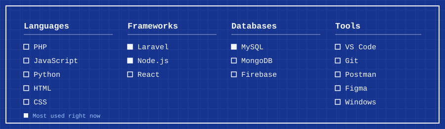

## About

I'm Bara, a backend developer. I build web applications with Laravel and Node.js, keep the data in MySQL, and try to write code that is still easy to read six months later. My best work happens with lofi playing.

- **Working on:** backend web applications
- **Learning:** Laravel, MySQL, Node.js, software architecture
- **Looking for guidance on:** clean code and system design
- **Open to:** open-source collaboration and new ideas
- **Ask me about:** Laravel, JavaScript, Firebase integration

## Stack

## Projects

## Activity

## Contact

- Email: [gamemasaw@email.com](mailto:gamemasaw@email.com)
- LinkedIn: [game-masaw](https://linkedin.com/in/game-masaw-1875133a9)
- Portfolio: [myportofolio-bara.netlify.app](https://myportofolio-bara.netlify.app)

If you want to say hi, I'm happy to chat.
